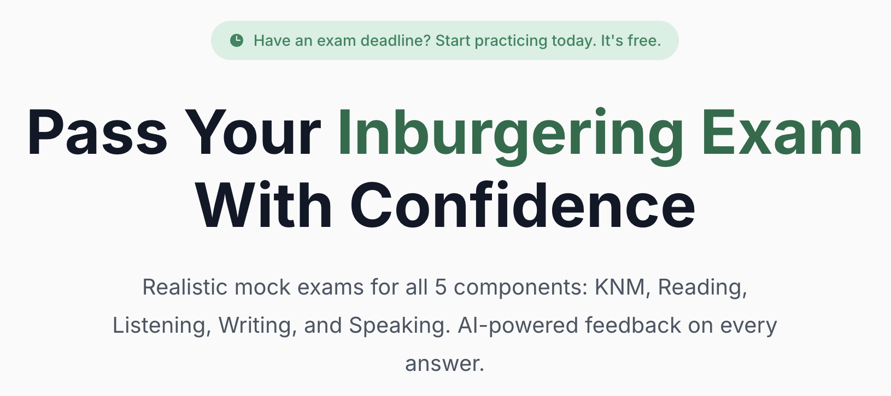

<div align="center">


# ExamKlaar

**Pass your Dutch inburgering exam with confidence**

Realistic, timed mock exams for all five components of the Dutch civic integration exam,
with AI feedback on every written and spoken answer.

[](https://github.com/RashadAnsari/examklaar/actions/workflows/build.yml)
[](src/data/exams)
[](docs/a2-exam-generation.md)
[](LICENSE)

[](https://nextjs.org)
[](https://react.dev)
[](https://www.typescriptlang.org)
[](https://bun.sh)
[](https://www.postgresql.org)
[](https://tailwindcss.com)

[**Live site**](https://examklaar.nl) · [**Documentation**](docs/) · [**Exam format**](docs/exam-format.md) · [**Contributing**](CONTRIBUTING.md)

</div>

---

<div align="center">
  
</div>

## What it is

Most people who move to the Netherlands from outside the EU have to pass the _inburgeringsexamen_,
five separate exams administered by DUO. DUO offers a few official practice exams, but its writing
and speaking practice gives no personal score or corrections, and the real exam reports only pass or
fail.

ExamKlaar fills that gap with more practice in the format of the real exam: the same structure,
the same timer, the same question types, the same media. Reading, listening and KNM are scored
instantly. Writing and speaking are graded by an AI examiner applying the official DUO assessment
models, with a score per aspect and every mistake corrected, so a candidate finds out where they
stand before paying €250 for the five exams at DUO. The pass marks are practice targets: DUO
publishes no cut scores.

ExamKlaar is free and open source. There is no paid plan and no payment code.

## The five components

| Component                                   | What the candidate does                                              | How it is scored                   |
| ------------------------------------------- | -------------------------------------------------------------------- | ---------------------------------- |
| **KNM** (_Kennis Nederlandse Maatschappij_) | Answers questions on Dutch society, history, culture and civic rules | Instantly, per answer key          |
| **Lezen** (Reading)                         | Reads Dutch texts and answers comprehension questions                | Instantly, per answer key          |
| **Luisteren** (Listening)                   | Listens to Dutch audio fragments and answers questions on them       | Instantly, per answer key          |
| **Schrijven** (Writing)                     | Writes short Dutch texts to a prompt                                 | AI examiner, DUO assessment models |
| **Spreken** (Speaking)                      | Records spoken answers to a video or audio prompt                    | AI examiner, DUO assessment model  |

Five exams per component, 25 in total, all at A2 level. KNM has no level, matching DUO.

## How it works

1. **Sign up** and confirm the email address. Every exam is free.
2. **Pick a component and an exam.** The exam opens with the real timer and no way to pause.
3. **Submit.** Closed questions score immediately, written and spoken answers go to the AI examiner.
4. **Review.** Every question is replayable next to the correct answer, the candidate's own answer,
   and the examiner's feedback, including the original recording for speaking.

## Tech stack

| Layer          | Choice                                                      |
| -------------- | ----------------------------------------------------------- |
| Framework      | Next.js 16 (App Router), React 19, TypeScript               |
| Styling        | Tailwind CSS 4, design tokens in `src/app/globals.css`      |
| Runtime, tests | Bun, `bun test`                                             |
| Database       | PostgreSQL 17, plain SQL migrations, `pg` pool              |
| Auth           | Better Auth, email and password with mandatory verification |
| AI grading     | Google AI via the Vercel AI SDK                             |
| Speech         | Transcription in the browser with Transformers.js           |
| Storage        | Any S3-compatible object storage, two buckets               |
| Email          | Brevo HTTP API                                              |
| Deployment     | Docker image built from `Dockerfile`                        |

## Quick start

```bash
bun install
make up         # local Postgres on port 5432
make migrate    # apply db/migrations
make dev        # http://localhost:3000
```

Copy `.env.example` to `.env.local` and fill it in. Postgres, Brevo, S3 storage and Google AI each
need values. The file documents what every variable is for.

The exam audio, images and video are not in git. Download `exam-assets.zip` from the
[latest release](https://github.com/RashadAnsari/examklaar/releases/latest), upload its contents to a
public bucket, and point `EXAM_ASSETS_BASE_URL` at it. See [Object storage](docs/infrastructure.md#object-storage).

`docker-compose.yml` at the repo root is the local development database only. To self-host, build
the `Dockerfile`, give the container the variables from `.env.example`, and run `node
scripts/migrate.js` in it after each release.

### Everyday commands

| Command          | What it does                                          |
| ---------------- | ----------------------------------------------------- |
| `make dev`       | Start the dev server                                  |
| `make local`     | Format, lint, typecheck and test, the full local gate |
| `make test`      | Run `bun test`                                        |
| `make coverage`  | Run the tests with coverage                           |
| `make build`     | Production build                                      |
| `make migrate`   | Apply `db/migrations` in order                        |
| `make db-shell`  | `psql` into the local database                        |
| `make up`/`down` | Start or stop the local database                      |

Run `make local` before every commit. CI runs the same targets, so a check that passes locally
passes there too.

## Project structure

```
src/
  app/              routes, API handlers and page components (App Router)
  components/       ui/ primitives, layout/, analytics/
  config/           site.ts, everything that identifies the product
  data/             exams/ the exam JSON, grading/ the DUO assessment models
  hooks/            shared client hooks
  lib/              db, auth, exam scoring and grading, storage, email
db/migrations/      numbered SQL migrations, applied by scripts/migrate.ts
docs/               authoring, generation and operations documentation
scripts/            migrate, delete-user
test/               test setup and the stub Postgres pool
```

## Documentation

The full index lives in [`docs/`](docs/README.md).

| Guide                                                    | What it covers                                                   |
| -------------------------------------------------------- | ---------------------------------------------------------------- |
| [Exam JSON format](docs/exam-format.md)                  | The schema, per-skill conventions and asset rules for exam data  |
| [A2 exam generation runbook](docs/a2-exam-generation.md) | How to author a new A2 exam for any component                    |
| [Dutch text-to-speech](docs/dutch-text-to-speech.md)     | Generating spoken Dutch audio locally for listening and speaking |
| [Image generation](docs/image-generation.md)             | Generating exam scene images locally                             |
| [Video generation](docs/video-generation.md)             | Generating talking-head video for speaking Part 1 prompts        |
| [Infrastructure](docs/infrastructure.md)                 | Database, auth, object storage and the media policy              |

[`AGENTS.md`](AGENTS.md) holds the conventions every change in this repository follows, for people
and for coding agents alike. Read it before touching code.

## Project skills

Project skills are Codex skills in `.agents/skills/`, invoked with `$`. `$generate-a2-exam` hands
its result to the `exam_reviewer` agent in `.codex/agents/`.

| Skill                                                            | What it does                                                                                                                                                                                |
| ---------------------------------------------------------------- | ------------------------------------------------------------------------------------------------------------------------------------------------------------------------------------------- |
| `$generate-a2-exam <reading\|listening\|writing\|speaking\|knm>` | Generates a new A2 exam for a component, writes the JSON into the exam data, and stages its assets folder (images via Codex, video local)                                                   |
| `$grade-a2-exam`                                                 | Grades any A2 writing or speaking answer, given its question, on the DUO assessment models with the same rules as the app's grader. Self-contained: the folder can be copied into any agent |

## License

[GNU Affero General Public License v3.0](LICENSE). If you run a modified version as a public
service, you must publish its source to its users.

The license covers the code and the exam content in this repository. It does not cover the
ExamKlaar name or logo.
